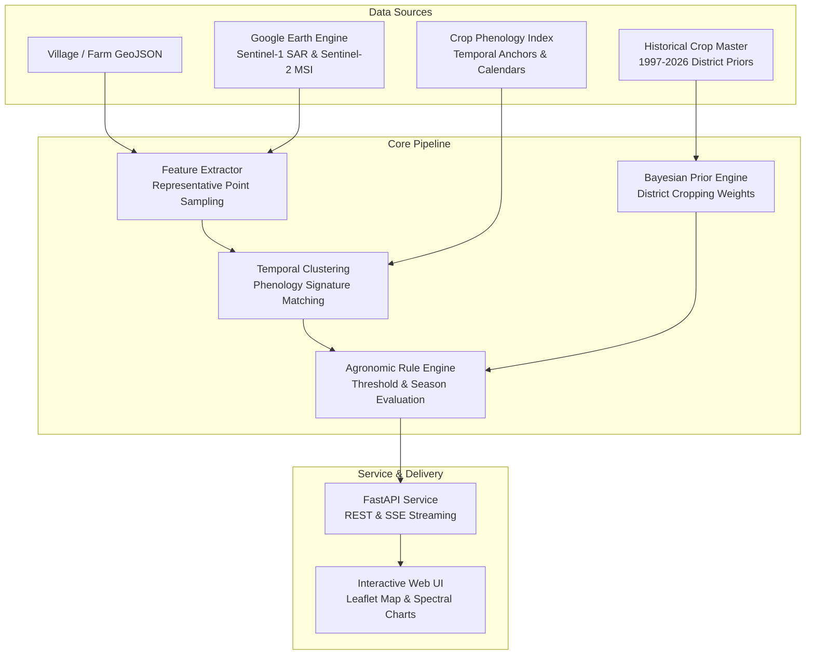

# 🌾 Maharashtra Crop Classifier (v0.7.0)

> **Time-Series Clustered & Rule-Based Geospatial Crop Classification Service for Maharashtra, India**

[](#-confidential--proprietary)
[](https://www.python.org/downloads/)
[](https://fastapi.tiangolo.com)
[](https://www.docker.com/)
[](https://leafletjs.com/)
[](https://earthengine.google.com/)

---

## 📌 Overview

The **Maharashtra Crop Classifier** is an internal agronomic intelligence system designed to classify crop varieties and farming regimes across Maharashtra at field and village scales.

Instead of forcing brittle black-box predictions on sparse labels, the system blends:
1. **Satellite Remote Sensing**: Sentinel-2 optical time series (NDVI, NDWI, EVI) and Sentinel-1 SAR backscatter (VV, VH) via Google Earth Engine.
2. **Bayesian District Priors**: Calibrated historical district cropping area patterns (1997–2026) to prevent implausible false positives (e.g., paddy in dry upland zones).
3. **Temporal Phenology Clustering**: Dynamic signature matching against empirical Maharashtra crop calendars (Kharif, Rabi, Summer/Zaid, Perennial).
4. **Agronomic Rule Engine**: Multi-tiered decision rules evaluating vegetation indices, radar canopy penetration, water index dynamics, and crop duration.
5. **Interactive GIS Dashboard**: High-performance web interface with live GeoJSON upload, real-time Server-Sent Events (SSE) streaming, and interactive map inspections.

---

## 🏛️ System Architecture



---

## ✨ Key Features

- **🚀 Dual Sensor Fusion (Optical + SAR)**: Ingests Sentinel-2 multispectral vegetation indices (`NDVI`, `NDWI`, `EVI`) combined with Sentinel-1 SAR dual-polarization (`VV`, `VH`, `VV/VH cross-ratio`) to penetrate monsoon cloud cover.
- **⚡ Fast Representative Sampling**: Samples interior polygon points (`representative_point()`) avoiding heavy cloud rasterization and bund/edge contamination, reducing feature extraction time from ~60s to ~2.5s per field.
- **📊 Bayesian District Priors**: Dynamically integrates historical cropping distribution percentages from `MH_Crop_Master_2015_2026.xlsx` across 36 Maharashtra districts.
- **📡 Real-time SSE Streaming**: Stream village classification results live via Server-Sent Events (`/classify-village/stream`), keeping the UI responsive during heavy geospatial batch operations.
- **🗺️ Interactive Map UI**: Built-in dark-themed GIS dashboard with Leaflet, farm polygon inspection, candidate score breakdowns, and spectral curve visualization.
- **🐳 Production Ready**: Zero-configuration containerization with Docker and Docker Compose, including health checks and non-root security.

---

## 🌾 Supported Crops & Regimes

| Regime / Season | Primary Supported Crops |
| :--- | :--- |
| **Kharif (Monsoon)** | Soybean, Cotton, Tur / Arhar (Pigeon Pea), Paddy (Rice), Bajra (Pearl Millet), Maize, Groundnut |
| **Rabi (Winter)** | Wheat, Gram (Chickpea), Jowar (Sorghum), Rapeseed & Mustard, Safflower |
| **Zaid / Summer** | Summer Paddy, Summer Groundnut, Maize |
| **Commercial / Perennial** | Sugarcane, Turmeric, Onion, Chilli |
| **Orchards & Fruit Trees** | Orange (Nagpur Mandarin), Banana, Mango, Sapota |

---

## 🚀 Quick Start

### 1. Run with Docker Compose (Recommended)

Ensure Docker is installed, then build and run:

```bash
docker compose up --build
```

The application will be live at:
- **Web Dashboard**: [http://localhost:8000](http://localhost:8000)
- **Interactive Swagger Docs**: [http://localhost:8000/docs](http://localhost:8000/docs)
- **Service Health Check**: [http://localhost:8000/health](http://localhost:8000/health)

---

### 2. Run with Docker CLI

```bash
# Build the container image
docker build -t crop-classifier .

# Run the container
docker run -d --name crop-classifier -p 8000:8000 crop-classifier

# (Optional) Mount local Google Earth Engine Service Account credentials
docker run -d --name crop-classifier -p 8000:8000 \
  -v "$(pwd)/gee_key_boundary-delineation-d7475f36cc6d.json":/app/credentials/gee_key.json:ro \
  -e GOOGLE_APPLICATION_CREDENTIALS=/app/credentials/gee_key.json \
  crop-classifier
```

---

### 3. Local Installation (Python 3.11+)

```bash
# Create and activate a virtual environment
python3 -m venv .venv
source .venv/bin/activate  # On Windows: .venv\Scripts\activate

# Install dependencies
pip install --upgrade pip
pip install -r requirements.txt

# Start the FastAPI server
uvicorn src.api.app:app --host 0.0.0.0 --port 8000 --reload
```

---

## 🔌 API Reference

### Health Check
```http
GET /health
```
```json
{
  "status": "ok",
  "service": "crop_classifier_api"
}
```

### Classify Single Field Profile
```http
POST /classify-field
Content-Type: application/json
```
```json
{
  "field_id": "field_001",
  "dominant_top_crop": "Cotton",
  "avg_kharif_share": 0.85,
  "avg_rabi_share": 0.12,
  "avg_zaid_share": 0.03,
  "top_crop_share": 0.65
}
```

### Classify Village (Batch or GeoJSON FeatureCollection)
```http
POST /classify-village
Content-Type: application/json
```
```json
{
  "village_id": "village_wardha_01",
  "district_name": "Wardha",
  "fields": [ ... ]
}
```

### Real-Time Streaming Classification (SSE)
```http
POST /classify-village/stream
Content-Type: application/json
```
*Emits real-time progression events (`geojson_validated` → `satellite_extraction` → `temporal_clustering` → `rule_engine`) and streams the classified payload.*

---

## 📂 Project Structure

```
crop_classifier_v2/
├── index.html                               # Modern GIS Web Interface (Leaflet + Charts)
├── requirements.txt                         # Python dependencies
├── Dockerfile                               # Multi-stage production container definition
├── docker-compose.yml                       # Docker orchestration & port mapping
├── .dockerignore                            # Container build ignore rules
│
├── MH_Crop_Master_2015_2026.xlsx            # District historical crop shares & Bayesian priors
├── Crop_Index_Exact_Temporal_Points.csv     # Phenology calendar curve anchors
├── Crop_Index_Range_Anchors_Not_Point_Series.csv
├── maharashtra_farms_cleaned.geojson        # Sample pilot farm polygons for UI testing
│
├── src/
│   ├── api/
│   │   └── app.py                          # FastAPI application and SSE streaming router
│   ├── config/
│   │   └── settings.py                     # Project root paths and configuration
│   ├── feature_engineering/
│   │   ├── build_region_features.py        # Historical region-level aggregation
│   │   └── sentinel_field_extractor.py     # Sentinel-1/2 Earth Engine extraction & caching
│   ├── ingestion/
│   │   ├── district_priors.py              # District Bayesian prior distribution engine
│   │   └── village_geojson.py              # GeoJSON polygon parser and normalizer
│   ├── labeling/
│   │   ├── cluster_labeling.py             # Cluster centroid agronomic labeling
│   │   ├── temporal_clustering.py          # K-Means & cosine similarity phenology matcher
│   │   └── temporal_reference.py           # Crop name canonicalization and index curves
│   ├── rules/
│   │   ├── field_candidate_generator.py    # Per-field multi-crop probability ranking
│   │   ├── rule_engine.py                  # Agronomic thresholding logic
│   │   └── village_classifier.py           # Village-wide crop breakdown & aggregation
│   ├── service/
│   │   └── classification_service.py       # Orchestrator integrating all components
│   └── utils/
│       └── paths.py                        # Path utilities
│
├── pipelines/                               # Standalone phase execution pipelines
│   ├── run_phase0_setup.py
│   ├── run_phase1_features.py
│   ├── run_phase2_clustering.py
│   ├── run_phase3_labeling.py
│   └── run_phase7_service.py
│
└── tests/                                   # Pytest automated test suites
    ├── test_api_endpoints.py
    ├── test_district_priors.py
    ├── test_field_extraction.py
    ├── test_phase7_service.py
    └── ...
```

---

## 🧪 Testing

Run automated checks across all phases:

```bash
pytest -v
```

To run a specific test suite:
```bash
pytest tests/test_phase7_service.py
pytest tests/test_api_endpoints.py
```

---

## 🔑 Earth Engine Authentication (Optional)

For live satellite extraction from Sentinel-1 & Sentinel-2, provide your Google Earth Engine Service Account key:

1. Place your service account JSON file in the project root (e.g. `gee_key_*.json`).
2. Alternatively, set the environment variable:
   ```bash
   export GOOGLE_APPLICATION_CREDENTIALS="/path/to/your/gee_service_account.json"
   ```
*(Note: If no key is configured, the system gracefully falls back to local disk caches and statistical district Bayesian priors.)*

---

## 🔒 Confidential & Proprietary

**Copyright © 2026 Cropgen. All Rights Reserved.**

This software, algorithms, data structures, and associated documentation are confidential and proprietary to Cropgen. Unauthorized copying, distribution, modification, public display, reverse engineering, or use of this source code or any part thereof, via any medium, is strictly prohibited.
